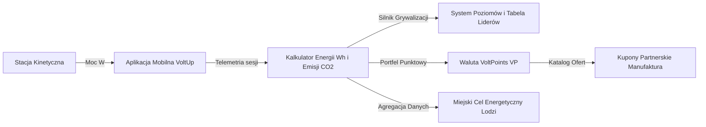

# VoltUp: Smart Kinetic Energy and Urban Fitness Eco-System

<p align="center">
  <a href="https://skillicons.dev">
    
  </a>
</p>

Aplikacja mobilna zrealizowana w architekturze Kotlin Multiplatform oraz Compose Multiplatform, integrująca miejską infrastrukturę sportowo-rekreacyjną z systemem pozyskiwania i monitorowania rozproszonej energii kinetycznej na obszarze aglomeracji łódzkiej.

---

## Spis Treści
1. [Architektura Rozwiązania](#architektura-rozwiązania)
2. [Moduły i Interfejs Użytkownika](#moduły-i-interfejs-użytkownika)
3. [Prezentacja Wizualna](#prezentacja-wizualna)
4. [Wideo Prezentacyjne](#wideo-prezentacyjne)
5. [Struktura Repozytorium](#struktura-repozytorium)
6. [Stos Technologiczny](#stos-technologiczny)
7. [Weryfikacja i Środowisko Uruchomieniowe](#weryfikacja-i-środowisko-uruchomieniowe)
8. [Integracje Usług Zewnętrznych](#integracje-usług-zewnętrznych)
9. [Licencja](#licencja)

---

## Architektura Rozwiązania

System VoltUp przetwarza pracę mechaniczną generowaną przez użytkowników na stacjach kinetycznych zlokalizowanych w przestrzeni publicznej miasta Łodzi. Wytworzona energia zasila lokalne punkty mikrosieci komunalnej, a zgromadzone dane telemetryczne podlegają bieżącej analizie i kwantyfikacji.

Przepływ danych obejmuje rejestrację parametrów sesji treningowej w czasie rzeczywistym, przeliczanie jednostek energii na ekwiwalent redukcji dwutlenku węgla oraz synchronizację z silnikiem grywalizacji w chmurze Google Firebase.



---

## Moduły i Interfejs Użytkownika

### Główny Pulpit Telemetryczny
Centralny widok aplikacji agreguje kluczowe wskaźniki efektywności energetycznej: sumaryczną liczbę wygenerowanych watogodzin, masę zredukowanej emisji dwutlenku węgla oraz wskaźnik ciągłości sesji treningowych. Dynamiczny wykres kołowo-słupkowy ilustruje dzienny rozkład generacji mocy w skali tygodnia, a moduł geolokalizacyjny FusedLocationProvider automatycznie wylicza odległość do najbliższych punktów ładowania.

### Dwuwarstwowy Moduł Kartograficzny
Obsługa mapy oparta jest na natywnej bibliotece Google Maps Compose z mechanizmem rezerwowym w postaci interaktywnej mapy wektorowej. Pinezki stacji odzwierciedlają status dostępności urządzeń, poziom mocy znamionowej oraz precyzyjne współrzędne geograficzne w układzie WGS84. Kliknięcie wybranego obiektu inicjuje płynną animację kamery do zbliżenia piętnastego stopnia oraz synchronizuje przewijanie listy stacji pod paskiem filtrów.

### Podsystem Skanowania Kodów Optycznych
Moduł CameraX odpowiada za analizę strumienia wideo pod kątem identyfikatorów stacji kinetycznych. Oprogramowanie wyposażono w buforowaną animację wizjera oraz wbudowany symulator sprzętowy, który umożliwia weryfikację logiki parowania w środowiskach emulatorowych pozbawionych fizycznego sensora optycznego.

### Monitorowanie Treningu w Czasie Rzeczywistym
Widok sesji treningowej prezentuje bieżący odczyt mocy chwilowej, zliczanie interwałowe spalonej energii metabolicznej oraz automatyczną detekcję bezczynności z funkcją wstrzymywania pomiaru. Po zakończeniu treningu rekord zostaje zwalidowany kryptograficznie i zapisany w kolekcji bazy danych.

### System Grywalizacji i Wymiany Punktowej
Aplikacja implementuje trzydzieści wielopoziomowych osiągnięć kategoryzowanych według kryteriów stażu, intensywności oraz eksploracji miejskiej. Wyzwania tygodniowe odnawiają się cyklicznie w każdy poniedziałek, a wygenerowane punkty VoltPoints podlegają natychmiastowej wymianie na jednorazowe kody alfanumeryczne do wykorzystania w punktach partnerskich.

---

## Prezentacja Wizualna

Interfejs użytkownika zaprojektowano w systemie Material Design 3 z pełnym wsparciem motywu ciemnego i jasnego oraz responsywnym układem elementów dla zróżnicowanych rozdzielczości ekranowych.

### Widoki Główne (Motyw Ciemny)

| Pulpit Główny | Mapa Kinetyczna | Aktywny Trening |
| :---: | :---: | :---: |
|  |  |  |

| Skaner QR | Osiągnięcia | Katalog Nagród |
| :---: | :---: | :---: |
|  |  |  |

| Profil Użytkownika | Historia Treningów | Ustawienia Aplikacji |
| :---: | :---: | :---: |
|  |  |  |

### Widoki Uwierzytelniania i Pomocnicze (Motyw Jasny)

| Ekran Logowania | Wprowadzenie | Przewodnik i FAQ |
| :---: | :---: | :---: |
|  |  |  |

---

## Wideo Prezentacyjne

Materiał demonstracyjny zarejestrowany bezpośrednio na fizycznym urządzeniu testowym prezentuje uruchomienie aplikacji, przepływ nawigacyjny, dynamiczną mapę stacji oraz cykl sesji treningowej:

Plik nagrania wideo znajduje się w repozytorium pod ścieżką:
`VoltUp_Screenshots/voltup_demo.mp4`

Rejestrację wideo z poziomu konsoli deweloperskiej na podłączonym urządzeniu Android wykonuje polecenie:

```bash
adb shell screenrecord --time-limit 20 /sdcard/voltup_demo.mp4
adb pull /sdcard/voltup_demo.mp4 ./VoltUp_Screenshots/voltup_demo.mp4
adb shell rm /sdcard/voltup_demo.mp4
```

---

## Struktura Repozytorium

```text
VoltUp/
├── androidApp/
│   ├── src/main/
│   │   ├── AndroidManifest.xml
│   │   └── res/
│   └── google-services.json
│
├── iosApp/
│   ├── iosApp/
│   │   ├── iOSApp.swift
│   │   └── ContentView.swift
│   └── iosApp.xcodeproj/
│
├── VoltUp_Screenshots/
│   ├── bez_ramki/
│   ├── z_ramka/
│   └── voltup_demo.mp4
│
└── shared/
    └── src/
        ├── commonMain/kotlin/com/lumatech/voltup/
        │   ├── App.kt
        │   ├── Models.kt
        │   ├── FirebaseModels.kt
        │   ├── VoltUpAuthService.kt
        │   ├── VoltUpDatabaseService.kt
        │   ├── AchievementSystem.kt
        │   ├── StationsMapScreen.kt
        │   ├── WorkoutScreen.kt
        │   ├── QrScannerScreen.kt
        │   ├── RewardsScreen.kt
        │   ├── ProfileScreen.kt
        │   ├── SettingsScreen.kt
        │   ├── AuthScreens.kt
        │   ├── Localization.kt
        │   └── Theme.kt
        │
        ├── androidMain/kotlin/com/lumatech/voltup/
        │   ├── GoogleMapView.android.kt
        │   ├── CameraPreview.android.kt
        │   └── FirebaseServices.android.kt
        │
        └── iosMain/kotlin/com/lumatech/voltup/
            ├── MainViewController.kt
            ├── GoogleMapView.ios.kt
            └── FirebaseServices.ios.kt
```

---

## Stos Technologiczny

| Warstwa | Technologia | Zastosowanie |
| :--- | :--- | :--- |
| Język rdzenia | Kotlin 2.0 | Logika domenowa, wieloplatformowość, współdzielony kod |
| Warstwa prezentacji | Compose Multiplatform | Deklaratywny interfejs graficzny dla systemów Android oraz iOS |
| Chmura obliczeniowa | Google Firebase | Usługi Firebase Auth, Cloud Firestore NoSQL, Realtime DB |
| Kartografia | Google Maps SDK Compose | Renderowanie wektorowe mapy miejskiej i obsługa zdarzeń dotykowych |
| Optyka i kamera | Jetpack CameraX | Przechwytywanie obrazu i analiza kodów kreskowych |
| Zarządzanie stanem | Kotlin Coroutines & StateFlow | Reaktywny model przetwarzania asynchronicznego danych |
| Geolokalizacja | FusedLocationProviderClient | Wyznaczanie pozycji GPS użytkownika i obliczanie dystansów |
| System typograficzny | Outfit Typeface Family | Współdzielone zasoby czcionek w standardzie Compose Resources |

---

## Weryfikacja i Środowisko Uruchomieniowe

### Wymagania wstępne
Kompilacja projektu wymaga środowiska Android Studio w wersji Iguana, Jellyfish lub nowszej, pakietu JDK w wersji 17 lub 21 oraz skonfigurowanego środowiska Android SDK z poziomem API minimum 26. Budowanie wersji dla systemu iOS wymaga systemu macOS ze środowiskiem Xcode 15 lub nowszym.

### Budowanie projektu w systemie Windows (PowerShell)
```powershell
$env:JAVA_HOME = "C:\Program Files\Android\Android Studio\jbr"
./gradlew compileDebugSources
```

### Budowanie projektu w systemie macOS lub Linux
```bash
export JAVA_HOME="/Applications/Android Studio.app/Contents/jbr/Contents/Home"
./gradlew compileDebugSources
```

### Instalacja pakietu debug na urządzeniu testowym
```bash
./gradlew :androidApp:installDebug
```

---

## Integracje Usług Zewnętrznych

### Baza danych Cloud Firestore
Komunikacja z bazą danych opiera się na czterech podstawowych kolekcjach:
Kolekcja `devices` przechowuje obiekty stacji kinetycznych wraz z ich koordynatami, parametrami elektrycznymi i stanem operacyjnym.
Kolekcja `users` utrzymuje metryki profilowe, liczbę punktów rankingowych, saldo waluty VoltPoints oraz poziom doświadczenia.
Kolekcja `workouts` archiwizuje zakończone sesje ćwiczeniowe z uwzględnieniem czasu trwania, średniej mocy, wygenerowanych watogodzin i estymacji emisji dwutlenku węgla.
Kolekcja `user_achievements` przechowuje stany progresji odblokowanych osiągnięć dla poszczególnych kont.

### Interfejs Google Maps API
Klucz autoryzacyjny Google Maps API zdefiniowany jest w pliku konfiguracyjnym manifestu oraz module mapowym. Do pełnego działania warstwy satelitarnej i wektorowej wymagane jest włączenie usługi Maps SDK for Android w konsoli Google Cloud Platform.

---

## Licencja

Oprogramowanie VoltUp objęte jest licencją MIT. Szczegółowe warunki użytkowania, modyfikacji oraz dystrybucji kodu źródłowego określa plik LICENSE dołączony do repozytorium.