<p align="center">
  <a href="#spis-treści">Wersja polska</a> &bull; <a href="#table-of-contents">English Version</a>
</p>

<p align="center">
  <a href="https://skillicons.dev">
    
  </a>
</p>

# VoltUp: Inteligentny Ekosystem Energii Kinetycznej i Fitnessu Miejskiego

Aplikacja mobilna zrealizowana w architekturze Kotlin Multiplatform oraz Compose Multiplatform, integrująca miejską infrastrukturę sportowo-rekreacyjną z systemem pozyskiwania i monitorowania rozproszonej energii kinetycznej na obszarze aglomeracji łódzkiej.

Projekt współdzieli sto procent kodu logiki biznesowej oraz interfejsu graficznego pomiędzy systemami Android oraz iOS, zachowując natywne punkty integracji ze sprzętem, kamerą oraz usługami geolokalizacyjnymi.

---

## Spis Treści

1. [Architektura Systemu i Kotlin Multiplatform](#architektura-systemu-i-kotlin-multiplatform)
2. [Przepływ Danych i Grywalizacja](#przepływ-danych-i-grywalizacja)
3. [Moduły i Interfejs Użytkownika](#moduły-i-interfejs-użytkownika)
4. [Prezentacja Wizualna](#prezentacja-wizualna)
5. [Wideo Prezentacyjne](#wideo-prezentacyjne)
6. [Struktura Repozytorium](#struktura-repozytorium)
7. [Stos Technologiczny](#stos-technologiczny)
8. [Kompilacja, Uruchomienie i Testy](#kompilacja-uruchomienie-i-testy)
9. [Integracje Usług Chmurowych](#integracje-usług-chmurowych)
10. [Licencja](#licencja)

---

## Architektura Systemu i Kotlin Multiplatform

Rozwiązanie VoltUp zostało zaprojektowane jako projekt Kotlin Multiplatform (KMP) zoptymalizowany pod kątem jednoczesnego wsparcia platform Android oraz iOS. Rdzeń systemu mieści się w module współdzielonym, eliminując konieczność duplikowania kodu pomiędzy różnymi środowiskami mobilnymi.

Moduł `/shared` stanowi wspólny fundament dla całej aplikacji Compose Multiplatform i dzieli się na dedykowane zbiory źródłowe:

* Katalog `commonMain` zawiera kod wspólny dla wszystkich platform docelowych, w tym deklaratywny interfejs użytkownika w technologii Compose Multiplatform, modele domenowe, maszyny stanowe MVI/MVVM, system obliczeń ekwiwalentu redukcji emisji dwutlenku węgla oraz silnik osiągnięć i wyzwań tygodniowych.
* Katalog `androidMain` implementuje natywne mechanizmy specyficzne dla systemu Android, wykorzystując wzorzec expect/actual. Znajdują się tu integracje z Google Maps SDK for Android (`GoogleMapView.android.kt`), podgląd kamery Jetpack CameraX do analizy kodów optycznych (`CameraPreview.android.kt`) oraz natywny zestaw bibliotek Google Play Services i Firebase SDK.
* Katalog `iosMain` dostarcza pomosty systemowe dla platformy iOS, w tym kontroler `MainViewController.kt` opakowujący drzewo komponentów Compose w natywny widok UIViewController, jak również dedykowane adaptery usług chmurowych.

Katalog `/iosApp` reprezentuje natywną aplikację iOS konfigurowaną w środowisku Xcode. Nawet przy pełnym współdzieleniu interfejsu w Compose Multiplatform, katalog ten definiuje punkt wejściowy dla platformy iOS oraz pozwala na dołączanie kodu SwiftUI (`iOSApp.swift`, `ContentView.swift`), jeśli wymagają tego specyficzne komponenty systemowe Apple.

---

## Przepływ Danych i Grywalizacja

System VoltUp przetwarza pracę mechaniczną generowaną przez użytkowników na stacjach kinetycznych zlokalizowanych w przestrzeni publicznej miasta Łodzi. Wytworzona energia zasila lokalne punkty mikrosieci komunalnej, a zgromadzone dane telemetryczne podlegają bieżącej analizie i kwantyfikacji.

Przepływ informacji obejmuje autoryzację sesji za pomocą kodu QR, rejestrację parametrów treningowych w czasie rzeczywistym, przeliczanie jednostek energii na ekwiwalent redukcji dwutlenku węgla oraz synchronizację z silnikiem grywalizacji w chmurze Google Firebase.

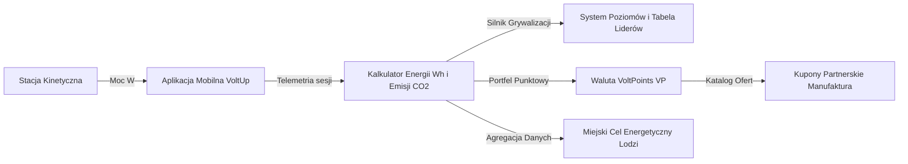

---

## Moduły i Interfejs Użytkownika

### Główny Pulpit Telemetryczny
Centralny widok aplikacji agreguje kluczowe wskaźniki efektywności energetycznej: sumaryczną liczbę wygenerowanych watogodzin, masę zredukowanej emisji dwutlenku węgla oraz wskaźnik ciągłości sesji treningowych. Dynamiczny wykres kołowo-słupkowy ilustruje dzienny rozkład generacji mocy w skali tygodnia, a moduł geolokalizacyjny FusedLocationProvider automatycznie wylicza odległość do najbliższych punktów ładowania. Trening może zostać zainicjowany wyłącznie po fizycznej weryfikacji urządzenia przez skaner kodów optycznych.

### Dwuwarstwowy Moduł Kartograficzny
Obsługa mapy oparta jest na natywnej bibliotece Google Maps Compose z mechanizmem rezerwowym w postaci interaktywnej mapy wektorowej. Pinezki stacji odzwierciedlają status dostępności urządzeń, poziom mocy znamionowej oraz precyzyjne współrzędne geograficzne w układzie WGS84 z dedykowanym cieniem przestrzennym. Kliknięcie wybranego obiektu inicjuje płynną animację kamery do zbliżenia na poziomie 15.5 stopnia oraz automatycznie synchronizuje przewijanie listy stacji pod paskiem filtrów.

### Podsystem Skanowania Kodów Optycznych
Moduł CameraX odpowiada za analizę strumienia wideo pod kątem identyfikatorów stacji kinetycznych. Oprogramowanie wyposażono w buforowaną animację wizjera oraz wbudowany symulator sprzętowy, który umożliwia weryfikację logiki parowania w środowiskach emulatorowych pozbawionych fizycznego sensora optycznego.

### Monitorowanie Treningu w Czasie Rzeczywistym
Widok sesji treningowej prezentuje bieżący odczyt mocy chwilowej, zliczanie interwałowe spalonej energii metabolicznej oraz automatyczną detekcję bezczynności z funkcją wstrzymywania pomiaru. Po zakończeniu treningu rekord zostaje zwalidowany i zapisany w chmurowej bazie danych.

### System Grywalizacji i Wymiany Punktowej
Aplikacja implementuje trzydzieści wielopoziomowych osiągnięć kategoryzowanych według kryteriów stażu, intensywności oraz eksploracji miejskiej. Wyzwania tygodniowe odnawiają się cyklicznie w każdy poniedziałek, a wygenerowane punkty VoltPoints podlegają natychmiastowej wymianie na jednorazowe kody alfanumeryczne do wykorzystania w punktach partnerskich.

---

## Prezentacja Wizualna

Interfejs użytkownika zaprojektowano w standardzie Material Design 3 z pełnym wsparciem motywu ciemnego i jasnego oraz adaptacyjnym układem elementów dla zróżnicowanych rozdzielczości ekranowych.

### Widoki Główne (Motyw Ciemny)

| Pulpit Główny | Mapa Kinetyczna | Aktywny Trening |
| :---: | :---: | :---: |
| 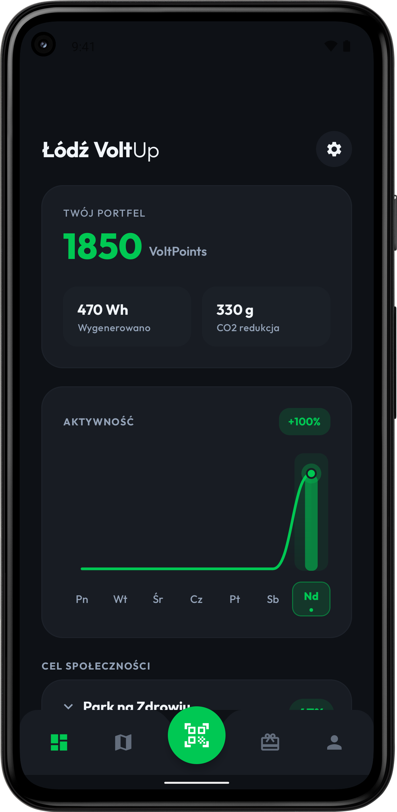 | 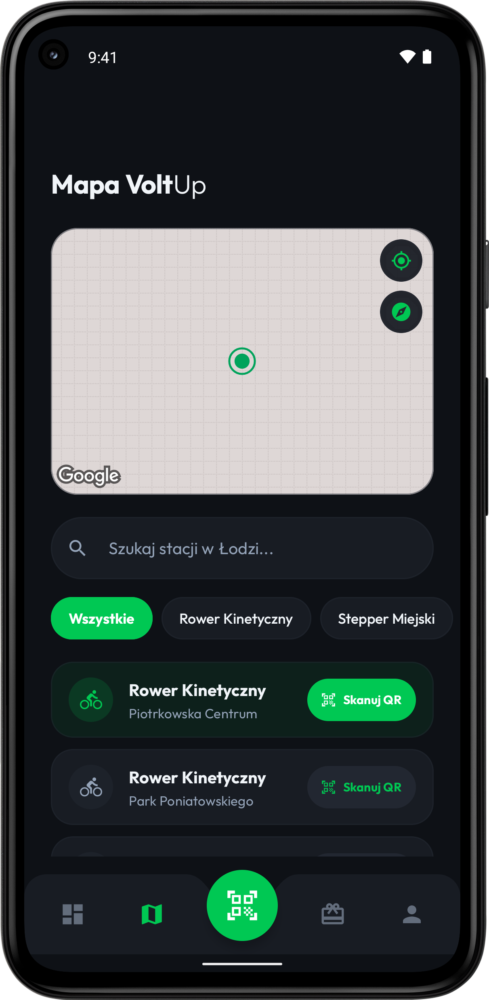 | 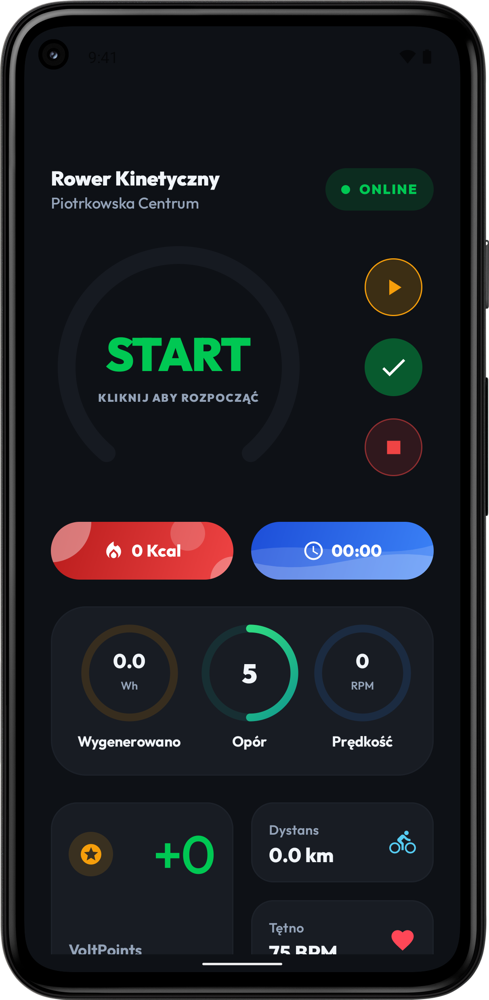 |

| Skaner QR | Osiągnięcia | Katalog Nagród |
| :---: | :---: | :---: |
| 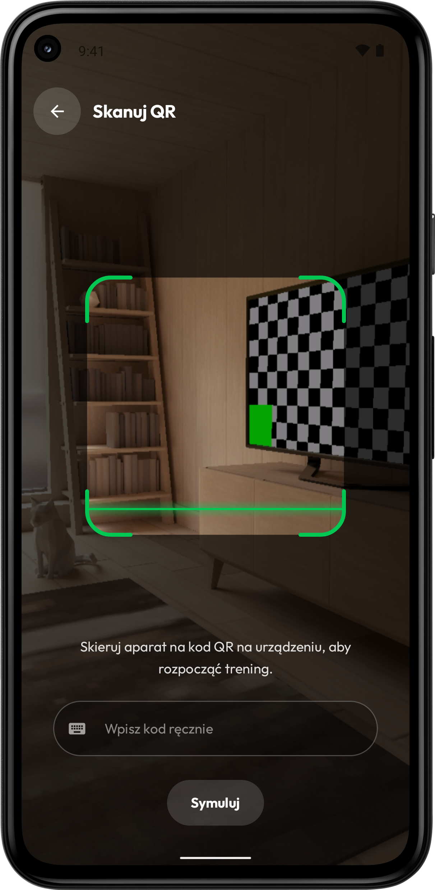 | 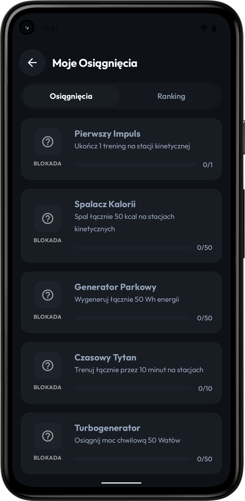 | 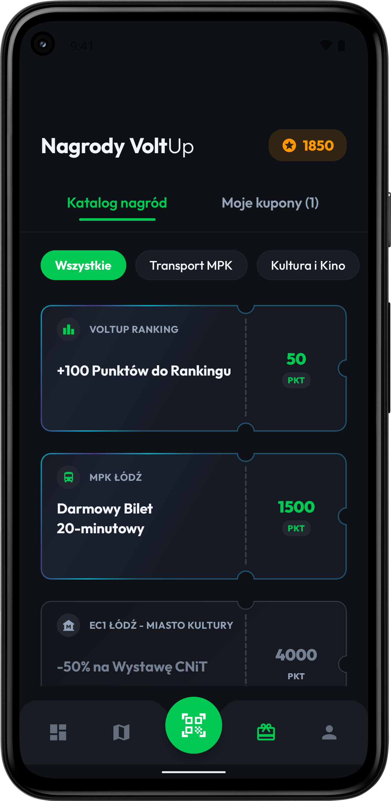 |

| Profil Użytkownika | Historia Treningów | Ustawienia Aplikacji |
| :---: | :---: | :---: |
| 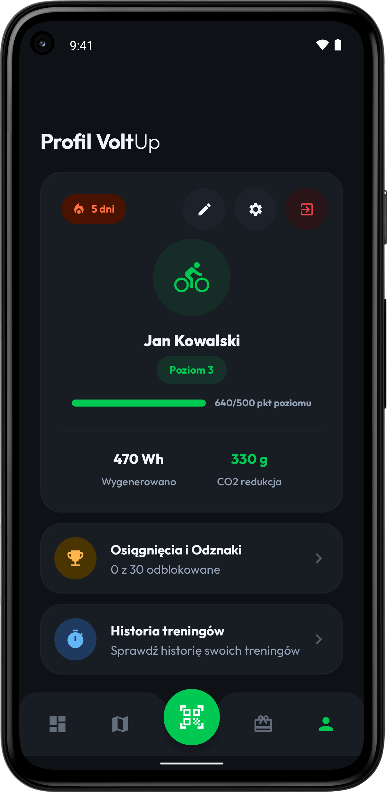 | 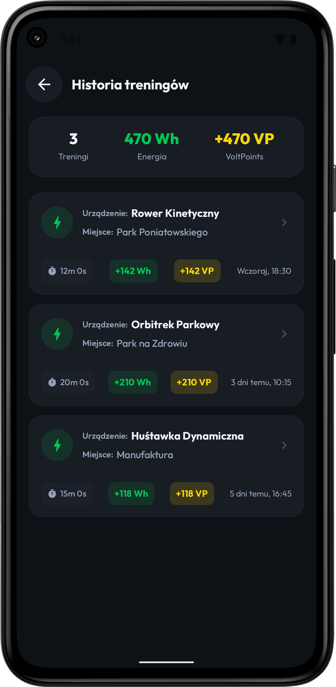 | 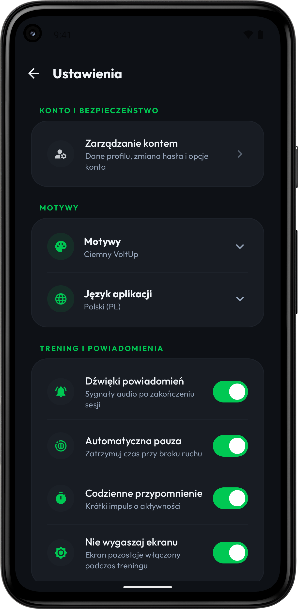 |

### Widoki Pomocnicze i Uwierzytelnianie (Motyw Jasny)

| Ekran Logowania | Wprowadzenie | Przewodnik i FAQ |
| :---: | :---: | :---: |
| 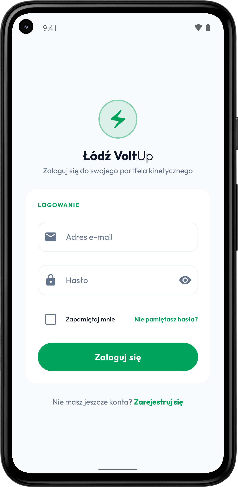 | 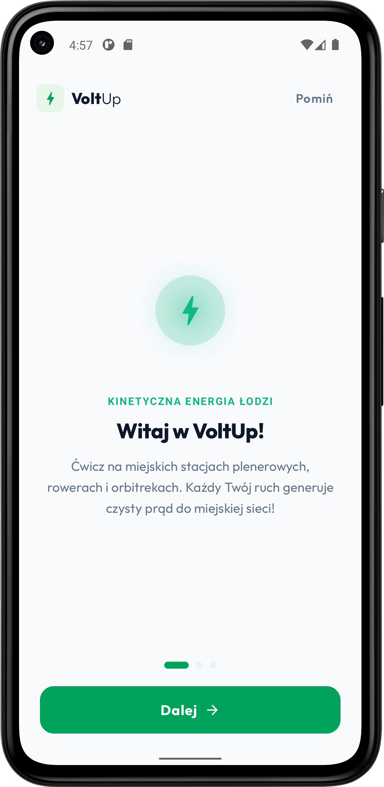 | 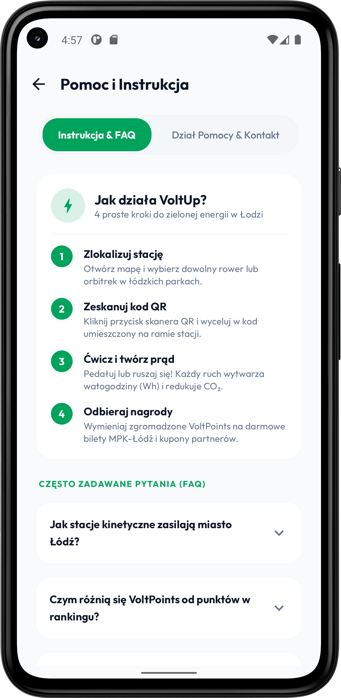 |

---

## Wideo Prezentacyjne

Zarejestrowany materiał demonstracyjny prezentuje pełny cykl pracy aplikacji: autoryzację, nawigację po punktach miejskich, skanowanie stacji oraz rejestrację sesji telemetrycznej.

Materiał wideo znajduje się w repozytorium pod ścieżką:
`VoltUp_Screenshots/voltup_demo.mp4`

Polecenia do bezpośredniej rejestracji obrazu urządzenia Android za pomocą konsoli ADB:

```bash
adb shell screenrecord --time-limit 20 /sdcard/voltup_demo.mp4
adb pull /sdcard/voltup_demo.mp4 ./VoltUp_Screenshots/voltup_demo.mp4
adb shell rm /sdcard/voltup_demo.mp4
```

---

## Struktura Repozytorium

```text
VoltUp/
├── androidApp/
│   ├── src/main/
│   │   ├── AndroidManifest.xml
│   │   └── res/
│   └── google-services.json
│
├── iosApp/
│   ├── iosApp/
│   │   ├── iOSApp.swift
│   │   └── ContentView.swift
│   └── iosApp.xcodeproj/
│
├── VoltUp_Screenshots/
│   ├── bez_ramki/
│   │   ├── ciemny/
│   │   └── jasny/
│   └── z_ramka/
│       ├── ciemny/
│       └── jasny/
│
└── shared/
    └── src/
        ├── commonMain/kotlin/com/lumatech/voltup/
        │   ├── App.kt
        │   ├── Models.kt
        │   ├── FirebaseModels.kt
        │   ├── VoltUpAuthService.kt
        │   ├── VoltUpDatabaseService.kt
        │   ├── AchievementSystem.kt
        │   ├── StationsMapScreen.kt
        │   ├── WorkoutScreen.kt
        │   ├── QrScannerScreen.kt
        │   ├── RewardsScreen.kt
        │   ├── ProfileScreen.kt
        │   ├── SettingsScreen.kt
        │   ├── AuthScreens.kt
        │   ├── Localization.kt
        │   └── Theme.kt
        │
        ├── androidMain/kotlin/com/lumatech/voltup/
        │   ├── GoogleMapView.android.kt
        │   ├── CameraPreview.android.kt
        │   └── FirebaseServices.android.kt
        │
        └── iosMain/kotlin/com/lumatech/voltup/
            ├── MainViewController.kt
            ├── GoogleMapView.ios.kt
            └── FirebaseServices.ios.kt
```

---

## Stos Technologiczny

| Warstwa | Technologia | Zastosowanie |
| :--- | :--- | :--- |
| Język bazowy | Kotlin 2.0 | Logika domenowa, wieloplatformowość, współdzielony kod |
| Warstwa prezentacji | Compose Multiplatform | Deklaratywny interfejs graficzny dla systemów Android oraz iOS |
| Chmura obliczeniowa | Google Firebase | Usługi Firebase Auth, Cloud Firestore NoSQL, Realtime DB |
| Kartografia | Google Maps SDK Compose | Renderowanie wektorowe mapy miejskiej i obsługa zdarzeń dotykowych |
| Optyka i kamera | Jetpack CameraX | Przechwytywanie obrazu i analiza kodów kreskowych |
| Zarządzanie stanem | Kotlin Coroutines & StateFlow | Reaktywny model przetwarzania asynchronicznego danych |
| Geolokalizacja | FusedLocationProviderClient | Wyznaczanie pozycji GPS użytkownika i obliczanie dystansów |
| System typograficzny | Outfit Typeface Family | Współdzielone zasoby czcionek w standardzie Compose Resources |

---

## Kompilacja, Uruchomienie i Testy

### Wymagania wstępne
Kompilacja projektu wymaga środowiska Android Studio (wersja Iguana, Jellyfish lub nowsza), pakietu JDK w wersji 17 lub 21 oraz skonfigurowanego środowiska Android SDK z poziomem API minimum 26. Budowanie wersji dla systemu iOS wymaga komputera z systemem macOS ze środowiskiem Xcode 15 lub nowszym.

### Budowanie i uruchamianie aplikacji Android

W systemie Windows (PowerShell):
```powershell
$env:JAVA_HOME = "C:\Program Files\Android\Android Studio\jbr"
./gradlew.bat :androidApp:assembleDebug
./gradlew.bat :androidApp:installDebug
```

W systemie macOS lub Linux:
```bash
export JAVA_HOME="/Applications/Android Studio.app/Contents/jbr/Contents/Home"
./gradlew :androidApp:assembleDebug
./gradlew :androidApp:installDebug
```

### Uruchamianie aplikacji iOS
Otwórz katalog `/iosApp` w środowisku Xcode i uruchom aplikację na wybranym symulatorze lub fizycznym urządzeniu z systemem iOS.

### Uruchamianie testów jednostkowych
Testy logiki wieloplatformowej uruchamiane są za pośrednictwem dedykowanych zadań Gradle:

Weryfikacja testów dla środowiska Android:
```bash
./gradlew :shared:testAndroidHostTest
```

Weryfikacja testów dla symulatora iOS:
```bash
./gradlew :shared:iosSimulatorArm64Test
```

---

## Integracje Usług Chmurowych

### Baza danych Cloud Firestore
Komunikacja z bazą danych opiera się na czterech podstawowych kolekcjach:
Kolekcja `devices` przechowuje obiekty stacji kinetycznych wraz z ich koordynatami, parametrami elektrycznymi i stanem operacyjnym.
Kolekcja `users` utrzymuje metryki profilowe, liczbę punktów rankingowych, saldo waluty VoltPoints oraz poziom doświadczenia.
Kolekcja `workouts` archiwizuje zakończone sesje ćwiczeniowe z uwzględnieniem czasu trwania, średniej mocy, wygenerowanych watogodzin i estymacji emisji dwutlenku węgla.
Kolekcja `user_achievements` przechowuje stany progresji odblokowanych osiągnięć dla poszczególnych kont.

### Interfejs Google Maps API
Klucz autoryzacyjny Google Maps API zdefiniowany jest w pliku konfiguracyjnym manifestu oraz module mapowym. Do pełnego działania warstwy satelitarnej i wektorowej wymagane jest włączenie usługi Maps SDK for Android w konsoli Google Cloud Platform.

---

## Licencja

Oprogramowanie VoltUp objęte jest licencją MIT. Szczegółowe warunki użytkowania, modyfikacji oraz dystrybucji kodu źródłowego określa plik [LICENSE](LICENSE) dołączony do repozytorium.

---
---

# VoltUp: Smart Kinetic Energy and Urban Fitness Eco-System

A mobile application developed with Kotlin Multiplatform and Compose Multiplatform, connecting urban fitness infrastructure with a decentralized kinetic energy harvesting and tracking network across the Lodz metropolitan area.

The project shares one hundred percent of domain business logic and user interface code between Android and iOS, while preserving native hardware integrations for camera feed, geolocation, and platform graphics rendering.

---

## Table of Contents

1. [Architecture and Kotlin Multiplatform](#architecture-and-kotlin-multiplatform)
2. [Data Pipeline and Gamification](#data-pipeline-and-gamification)
3. [Modules and User Interface](#modules-and-user-interface)
4. [Visual Presentation](#visual-presentation)
5. [Presentation Video](#presentation-video)
6. [Repository Structure](#repository-structure)
7. [Technology Stack](#technology-stack)
8. [Building, Running, and Testing](#building-running-and-testing)
9. [Cloud Services Integration](#cloud-services-integration)
10. [License](#license-1)

---

## Architecture and Kotlin Multiplatform

VoltUp is built as a Kotlin Multiplatform (KMP) project targeting both Android and iOS. The core of the system resides in the shared module, removing the necessity of maintaining duplicate codebases across platforms.

The `/shared` directory represents the unified multiplatform module powering Compose Multiplatform and is organized into specific source sets:

* The `commonMain` directory contains cross-platform code shared across all compilation targets. This includes the Compose Multiplatform declarative user interface, domain models, MVI/MVVM reactive state machines, emission reduction calculus, and the weekly challenge evaluation engine.
* The `androidMain` directory implements Android-specific mechanisms using the expect/actual design pattern. It contains integrations with Google Maps SDK for Android (`GoogleMapView.android.kt`), the Jetpack CameraX optical code analysis pipeline (`CameraPreview.android.kt`), and native Google Play Services alongside the Firebase Android SDK.
* The `iosMain` directory provides platform bridges for Apple systems, including `MainViewController.kt` which encapsulates the Compose component tree within a native UIViewController, as well as cloud service adapters.

The `/iosApp` directory contains the native iOS application configured in Xcode. Even when sharing the complete UI layer through Compose Multiplatform, this directory serves as the required entry point for the iOS platform and provides the location for any platform-specific SwiftUI implementations (`iOSApp.swift`, `ContentView.swift`).

---

## Data Pipeline and Gamification

VoltUp converts physical mechanical work performed by citizens on kinetic fitness stations into measurable electrical units. The generated electrical output supplies local municipal microgrid nodes, while collected telemetry is quantified and synchronized in real time.

The data flow incorporates QR authentication, continuous session telemetry logging, energy-to-carbon offset conversion formulas, and real-time synchronization with the cloud gamification engine hosted on Google Firebase.

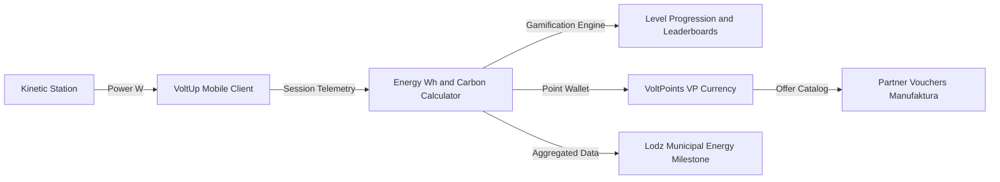

---

## Modules and User Interface

### Primary Telemetry Dashboard
The central dashboard aggregates core sustainability metrics: cumulative watt-hours generated, mass of prevented carbon dioxide emissions, and active workout streaks. A dynamic circular and bar gauge displays weekly power generation patterns, while FusedLocationProvider calculates real-time proximity to nearby kinetic stations. Workouts are strictly initiated through physical optical scanning to preserve telemetry integrity.

### Dual-Layer Cartographic System
The map module utilizes Google Maps Compose backed by an interactive vector fallback. Pins represent device operational statuses, rated power thresholds, and precise WGS84 geographic coordinates rendered with subtle spatial ground shadows. Selecting a pin triggers smooth camera translation with a zoom level of 15.5 and automatically synchronizes the horizontal card carousel beneath filter controls.

### Optical Code Scanner Subsystem
The CameraX subsystem handles frame analysis for kinetic station identifiers. It features buffered reticle guidance and an integrated hardware simulator, enabling full pairing lifecycle testing within emulator environments lacking physical camera sensors.

### Real-Time Session Monitoring
The active workout monitor provides instantaneous wattage readouts, metabolic energy computation, and automatic idle detection with pause functionality. Upon session completion, the telemetry record is validated and persisted to the cloud database.

### Progression and Rewards Catalog
Thirty multi-tier achievements evaluate user dedication, training intensity, and municipal exploration. Weekly challenges renew every Monday, and earned VoltPoints can be redeemed immediately for unique alphanumeric vouchers valid at commercial partner locations.

---

## Visual Presentation

The application interface is styled in accordance with Material Design 3 specifications, featuring comprehensive dark and light theme palettes alongside adaptive element layouts for diverse screen aspect ratios.

### Core Screens (Dark Theme)

| Primary Dashboard | Kinetic Stations Map | Active Workout |
| :---: | :---: | :---: |
|  |  |  |

| QR Scanner | Achievements | Rewards Catalog |
| :---: | :---: | :---: |
|  |  |  |

| User Profile | Workout History | Application Settings |
| :---: | :---: | :---: |
|  |  |  |

### Auxiliary Screens and Authentication (Light Theme)

| Login Screen | Onboarding Overview | Guide and FAQ |
| :---: | :---: | :---: |
|  |  |  |

---

## Presentation Video

The demonstration recording demonstrates app initialization, navigation flows, interactive map interactions, and the complete telemetry workout cycle.

The video file is located in the repository at:
`VoltUp_Screenshots/voltup_demo.mp4`

Commands to record device screen capture directly via ADB:

```bash
adb shell screenrecord --time-limit 20 /sdcard/voltup_demo.mp4
adb pull /sdcard/voltup_demo.mp4 ./VoltUp_Screenshots/voltup_demo.mp4
adb shell rm /sdcard/voltup_demo.mp4
```

---

## Repository Structure

```text
VoltUp/
├── androidApp/
│   ├── src/main/
│   │   ├── AndroidManifest.xml
│   │   └── res/
│   └── google-services.json
│
├── iosApp/
│   ├── iosApp/
│   │   ├── iOSApp.swift
│   │   └── ContentView.swift
│   └── iosApp.xcodeproj/
│
├── VoltUp_Screenshots/
│   ├── bez_ramki/
│   │   ├── ciemny/
│   │   └── jasny/
│   └── z_ramka/
│       ├── ciemny/
│       └── jasny/
│
└── shared/
    └── src/
        ├── commonMain/kotlin/com/lumatech/voltup/
        │   ├── App.kt
        │   ├── Models.kt
        │   ├── FirebaseModels.kt
        │   ├── VoltUpAuthService.kt
        │   ├── VoltUpDatabaseService.kt
        │   ├── AchievementSystem.kt
        │   ├── StationsMapScreen.kt
        │   ├── WorkoutScreen.kt
        │   ├── QrScannerScreen.kt
        │   ├── RewardsScreen.kt
        │   ├── ProfileScreen.kt
        │   ├── SettingsScreen.kt
        │   ├── AuthScreens.kt
        │   ├── Localization.kt
        │   └── Theme.kt
        │
        ├── androidMain/kotlin/com/lumatech/voltup/
        │   ├── GoogleMapView.android.kt
        │   ├── CameraPreview.android.kt
        │   └── FirebaseServices.android.kt
        │
        └── iosMain/kotlin/com/lumatech/voltup/
            ├── MainViewController.kt
            ├── GoogleMapView.ios.kt
            └── FirebaseServices.ios.kt
```

---

## Technology Stack

| Layer | Technology | Function |
| :--- | :--- | :--- |
| Core Language | Kotlin 2.0 | Domain logic, multiplatform bindings, shared codebase |
| UI Framework | Compose Multiplatform | Declarative graphical user interface for Android and iOS |
| Cloud Services | Google Firebase | Authentication, Cloud Firestore NoSQL, Realtime DB |
| Cartography | Google Maps SDK Compose | Vector rendering of municipal map and touch interaction |
| Optics and Camera | Jetpack CameraX | Frame acquisition and barcode analysis |
| Concurrency and State | Kotlin Coroutines & StateFlow | Reactive asynchronous data streams and state containers |
| Geolocation | FusedLocationProviderClient | Real-time user GPS tracking and distance computation |
| Typography | Outfit Typeface Family | Shared font resources packaged via Compose Resources |

---

## Building, Running, and Testing

### Prerequisites
Compilation requires Android Studio (Iguana, Jellyfish or newer), JDK 17 or JDK 21, and Android SDK configured with a minimum API level of 26. Building for iOS requires macOS with Xcode 15 or newer.

### Building and Running Android App

On Windows (PowerShell):
```powershell
$env:JAVA_HOME = "C:\Program Files\Android\Android Studio\jbr"
./gradlew.bat :androidApp:assembleDebug
./gradlew.bat :androidApp:installDebug
```

On macOS or Linux:
```bash
export JAVA_HOME="/Applications/Android Studio.app/Contents/jbr/Contents/Home"
./gradlew :androidApp:assembleDebug
./gradlew :androidApp:installDebug
```

### Running iOS App
Open the `/iosApp` directory in Xcode and run the project targeting a simulator or connected physical iOS device.

### Running Unit Tests
Multiplatform unit tests can be executed through the following Gradle tasks:

Android unit tests:
```bash
./gradlew :shared:testAndroidHostTest
```

iOS simulator unit tests:
```bash
./gradlew :shared:iosSimulatorArm64Test
```

---

## Cloud Services Integration

### Cloud Firestore Database
Database persistence relies on four primary collections:
The `devices` collection maintains kinetic station records including GPS coordinates, power ratings, and maintenance states.
The `users` collection stores user metrics, ranking scores, VoltPoints balances, and progression levels.
The `workouts` collection records completed exercise sessions with durations, mean power outputs, generated watt-hours, and carbon offsets.
The `user_achievements` collection manages achievement progress and unlocked tiers per user account.

### Google Maps API Configuration
The Google Maps API key is declared within the Android manifest configuration and map composables. Full map functionality requires enabling the Maps SDK for Android within Google Cloud Console.

---

## License

VoltUp is distributed under the terms of the MIT License. Refer to the [LICENSE](LICENSE) file for complete details regarding permitted use, distribution, and warranty terms.