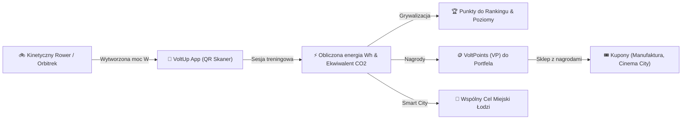

# ⚡ VoltUp — Smart Kinetic Energy & Urban Fitness Eco-System

<p align="center">
  
</p>

<p align="center">
  <b>Przekształcaj energię kinetyczną w zieloną moc dla miasta Łodzi, zbieraj VoltPoints i odbieraj nagrody u partnerów!</b>
</p>

<p align="center">
  <a href="#-o-projekcie"></a>
  <a href="#-architektura-i-struktura-projektu"></a>
  <a href="#-wykorzystane-technologie"></a>
  <a href="#-wykorzystane-technologie"></a>
  <a href="#-instrukcja-uruchomienia"></a>
  
  
</p>

---

## 📑 Spis Treści
- [🌟 O Projekcie](#-o-projekcie)
- [✨ Kluczowe Funkcjonalności](#-kluczowe-funkcjonalności)
- [🎮 Grywalizacja & Ekonomia VoltPoints](#-grywalizacja--ekonomia-voltpoints)
- [🗺️ Mapa Kinetyczna i Stacje w Łodzi](#️-mapa-kinetyczna-i-stacje-w-łodzi)
- [🎥 Symulacja Treningu Kinetycznego (Demo)](#-symulacja-treningu-kinetycznego-demo)
- [🏗️ Architektura i Struktura Projektu](#️-architektura-i-struktura-projektu)
- [🛠️ Wykorzystane Technologie](#️-wykorzystane-technologie)
- [🚀 Instrukcja Uruchomienia](#-instrukcja-uruchomienia)
- [🔐 Konfiguracja Usług Zewnętrznych](#-konfiguracja-usług-zewnętrznych)
- [🗺️ Roadmapa Rozwoju](#️-roadmapa-rozwoju)
- [👥 Licencja i Autorzy](#-licencja-i-autorzy)

---

## 🌟 O Projekcie

**VoltUp** to nowoczesna aplikacja mobilna stworzona w oparciu o **Kotlin Multiplatform (KMP)** oraz **Compose Multiplatform**, łącząca miejską rekreację, ekologię i koncepcję Smart City.

Główną ideą projektu jest zachęcenie mieszkańców i odwiedzających Łódź do aktywności fizycznej na specjalnych, **kinetycznych stacjach treningowych** zlokalizowanych w popularnych punktach miasta (m.in. *Piotrkowska Centrum, Rynek w Manufakturze, Park Poniatowskiego, Park na Zdrowiu, Park Źródliska, EC1 Łódź*).

Wytworzona podczas treningu energia elektryczna zasila lokalną mikrosieć miejską (np. punkty ładowania USB, oświetlenie alejek), a użytkownik w zamian otrzymuje:
1. **Punkty do globalnego rankingu** — rywalizacja o tytuły i poziomy mistrzowskie.
2. **VoltPoints (VP)** — dedykowaną walutę wymienialną w aplikacji na realne rabaty i kupony u partnerów miejskich (kino, gastronomia, bilety).
3. **Ekologiczny feedback** — precyzyjny wskaźnik zaoszczędzonej emisji $CO_2$ oraz wkład w **Miejski Cel Energetyczny**.



---

## ✨ Kluczowe Funkcjonalności

### 📱 1. Pulpit Mieszkańca (Dashboard)
- **Karty statystyk na żywo**: całkowita wygenerowana energia ($Wh$), redukcja $CO_2$ ($g/kg$), poziom i seria dni treningowych (*streak days* z płonącą ikoną ognia).
- **Aktywność tygodniowa**: dynamiczny wykres słupkowy prezentujący energię wygenerowaną w poszczególnych dniach tygodnia.
- **Wspólny cel Łodzi**: pasek postępu energii kinetycznej wygenerowanej przez całą społeczność miasta.
- **Sekcja „W pobliżu”**: automatyczne wykrywanie najbliższych stacji kinetycznych na podstawie współrzędnych GPS wraz z odległością w metrach/kilometrach.

### 🗺️ 2. Interaktywna Mapa Stacji w Łodzi
- **Hybrydowy silnik mapy**: pełna integracja z natywnym **Google Maps** (`maps-compose`) z automatycznym, płynnym przejściem na **Interaktywną Mapę Schematyczną** w przypadku braku usług Google Play.
- **Wizualizacja stacji**: pinezki w barwach marki VoltUp (`#00A35B` / `#1E824C`) z cieniem rzucanym na podłoże (*ground drop shadow*) i dynamiczną poświatą (*pulse halo*).
- **Inteligentne centrowanie i zoom**: kliknięcie w pinezkę płynnie przybliża kamerę (zoom `15.5f`) na wybraną stację i automatycznie przewija listę urządzeń pod filtrami na samą górę.
- **Filtrowanie i wyszukiwarka**: filtrowanie według kategorii urządzenia (Rower, Orbitrek, Stepper, Huśtawka, Ławka solarna) oraz wyszukiwanie po nazwie, dzielnicy i adresie.

### 📷 3. Błyskawiczny Skaner Kodów QR
- Zintegrowany podgląd kamery z animowaną linią skanowania i celownikiem.
- Natychmiastowe rozpoznawanie identyfikatorów stacji (np. `LDZ-MF-1`, `LDZ-PP-1`).
- **Tryb symulacji**: możliwość testowania parowania stacji bezpośrednio w emulatorze bez fizycznej kamery.

### 🏋️ 4. Ekran Aktywnego Treningu (Workout Live Session)
- Cyfrowy i analogowy wskaźnik aktualnej mocy kinetycznej ($W$).
- Liczniki w czasie rzeczywistym: wygenerowane $Wh$, spalone kalorie ($kcal$), zaoszczędzone $CO_2$ oraz zdobywane VoltPoints.
- Opcja automatycznego wstrzymywania treningu przy braku ruchu (*Auto-Pause*).
- Zapisywanie sesji treningowej w historii w chmurze Firestore.

### 🎟️ 5. Portfel Nagród i Kuponów (Marketplace)
- Przejrzysty podgląd salda **VoltPoints**.
- Katalog nagród i ofert partnerów miejskich (np. seanse Cinema City, zniżki w restauracjach, bilety rankingowe).
- Generowanie unikalnego kodu kuponu z możliwością skopiowania do schowka jednym kliknięciem.

### 👤 6. Profil i Zaawansowane Zarządzanie Kontem
- Awatary użytkownika, edycja imienia, wskaźnik poziomu i tytułu (np. *„Ekologiczny Odkrywca”*).
- Bezpieczne zarządzanie kontem: zmiana hasła, reset hasła na e-mail, wylogowanie z potwierdzeniem.
- Pełne usuwanie konta (zgodne z RODO) z kaskadowym czyszczeniem danych w Firebase Firestore.

---

## 🎮 Grywalizacja & Ekonomia VoltPoints

| Komponent | Opis |
| :--- | :--- |
| **30 Osiągnięć (Trophy System)** | Trzypoziomowe osiągnięcia (Brąz 🥉, Srebro 🥈, Złoto 🥇) premiujące treningi, regularność, eksplorację miasta i redukcję $CO_2$. Zapewniają punkty rankingowe i dedykowane powiadomienia Snackbar. |
| **Wyzwania Tygodniowe** | Rotacyjne zadania odnawiane w każdy poniedziałek (np. wygeneruj 150 Wh, zrób 3 treningi). Nowoczesna animacja ukończenia z płynnym wysunięciem kafelka. |
| **Tabela Liderów & Poziomy** | System poziomów oparty na punktach rankingowych z precyzyjnymi progami awansu (0 - 3000+ pkt). |
| **Streak Days** | Licznik nieprzerwanej serii dni treningowych motywujący do regularnych ćwiczeń. |

---

## 🗺️ Mapa Kinetyczna i Stacje w Łodzi

Aplikacja dynamicznie pobiera sieć urządzeń z bazy **Cloud Firestore** z automatycznym dopasowywaniem współrzędnych i dzielnic:

```
📍 Manufaktura (Rynek)          — Huśtawka Dynamiczna (120 W)       [Bałuty]
📍 Park Poniatowskiego           — Rower Kinetyczny (180 W)          [Polesie]
📍 Park na Zdrowiu              — Orbitrek Parkowy (220 W)          [Polesie]
📍 Piotrkowska Centrum          — Rower Kinetyczny (250 W)          [Śródmieście]
📍 Park Źródliska               — Stepper Miejski (160 W)           [Widzew]
📍 EC1 Łódź                     — Rower Generator (250 W)           [Śródmieście]
📍 Park Matejki                 — Stepper Parkowy (150 W)           [Śródmieście]
📍 Stawy Stefańskiego           — Orbitrek Nadwodny (200 W)         [Górna]
```

---

## 🎥 Symulacja Treningu Kinetycznego (Demo)

Aplikacja posiada wbudowane środowisko symulacyjne, pozwalające na testowanie pełnego cyklu życia treningu bez fizycznego urządzenia:

```
[Skanuj QR] ➜ [Wybór Stacji: MF-1] ➜ [Start Treningu] ➜ [Generowanie 140W] ➜ [Zapis w Chmurze] ➜ [+50 VP, +120 Pkt]
```

```
┌────────────────────────────────────────────────────────┐
│                   TRENING KINETYCZNY                   │
│                Huśtawka Dynamiczna #MF-1               │
│                                                        │
│                     ⚡ 142.5 W ⚡                      │
│                 [   ||||||||||||░░░   ]                │
│                                                        │
│     CZAS: 18:24 min               ENERGIA: 42.6 Wh     │
│     KALORIE: 114 kcal             CO2: -28 g           │
│     PUNKTY: +42 VP                STATUS: ŁADOWANIE    │
│                                                        │
│              [ ZAKOŃCZ I ZAPISZ TRENING ]              │
└────────────────────────────────────────────────────────┘
```

---

## 🏗️ Architektura i Struktura Projektu

Projekt korzysta ze standardu **Kotlin Multiplatform** z podziałem na moduły platformowe oraz współdzielony moduł UI/domeny:

```text
VoltUp/
├── androidApp/                     # Natywna aplikacja Android (Application Entry Point)
│   ├── src/main/
│   │   ├── AndroidManifest.xml     # Uprawnienia (Aparat, GPS, Internet)
│   │   └── res/                    # Ikony mipmap, kolory i style launchera
│   └── google-services.json        # Konfiguracja Firebase dla Androida
│
├── iosApp/                         # Natywna aplikacja iOS (SwiftUI & Xcode wrapper)
│   ├── iosApp/
│   │   ├── iOSApp.swift            # Punkt wejścia SwiftUI
│   │   └── ContentView.swift       # Wywołanie MainViewController z Compose Multiplatform
│   └── iosApp.xcodeproj/
│
└── shared/                         # Główny współdzielony kod projektu (KMP + Compose)
    └── src/
        ├── commonMain/kotlin/com/lumatech/voltup/
        │   ├── App.kt                  # Główny kontener nawigacji, BottomBar, Pager
        │   ├── Models.kt               # Modele domenowe (Station, Workout, User, Challenge)
        │   ├── FirebaseModels.kt       # DTO i transformacje danych Firestore
        │   ├── VoltUpAuthService.kt    # Interfejs autoryzacji (expect/actual)
        │   ├── VoltUpDatabaseService.kt# Interfejs bazy danych (expect/actual)
        │   ├── AchievementSystem.kt    # Silnik 30 osiągnięć i naliczania postępów
        │   ├── StationsMapScreen.kt    # Ekran mapy, lista kafelków, filtry
        │   ├── WorkoutScreen.kt        # Ekran aktywnego treningu i telemetrii
        │   ├── QrScannerScreen.kt      # Skaner kodów QR i simulator parowania
        │   ├── RewardsScreen.kt        # Sklep z nagrodami i portfel kuponów
        │   ├── ProfileScreen.kt        # Profil użytkownika, wykresy, statystyki
        │   ├── SettingsScreen.kt       # Ustawienia dźwięków, motywu, języka
        │   ├── AuthScreens.kt          # Logowanie, rejestracja, reset hasła
        │   ├── Localization.kt         # Tłumaczenia dwujęzyczne (PL / EN)
        │   └── Theme.kt                # Paleta kolorów VoltUp, Material 3, Dark Mode
        │
        ├── androidMain/kotlin/com/lumatech/voltup/
        │   ├── GoogleMapView.android.kt # Implementacja Google Maps & mapy schematycznej
        │   ├── CameraPreview.android.kt # Implementacja CameraX dla skanera QR
        │   └── FirebaseServices.android.kt # Implementacja Firebase SDK na Androida
        │
        └── iosMain/kotlin/com/lumatech/voltup/
            ├── MainViewController.kt   # UIViewController integrujący Compose w iOS
            ├── GoogleMapView.ios.kt     # Widok mapy dla iOS
            └── FirebaseServices.ios.kt  # Usługi chmurowe dla iOS
```

---

## 🛠️ Wykorzystane Technologie

- **Język bazowy**: [Kotlin 2.0+](https://kotlinlang.org/)
- **UI Framework**: [Compose Multiplatform](https://www.jetbrains.com/lp/compose-multiplatform/) (100% deklaratywny, współdzielony kod UI w Material Design 3)
- **Architektura**: Clean Architecture + MVI/MVVM pattern ze stanem `StateFlow` i `rememberSaveable`
- **Chmura i Autoryzacja**: 
  - **Firebase Authentication** — bezpieczne logowanie, rejestracja i reset haseł
  - **Cloud Firestore** — baza dokumentowa NoSQL czasu rzeczywistego (urządzenia, sesje, ranking)
- **Mapy i Geolokalizacja**:
  - **Google Maps SDK for Android** (`com.google.maps.android:maps-compose`)
  - **FusedLocationProviderClient** — precyzyjne namierzanie pozycji użytkownika
- **Kamera**: **CameraX** (`androidx.camera`) — analiza klatek obrazu pod kątem kodów QR
- **Wielowątkowość**: **Kotlin Coroutines** & **Kotlin Flows**
- **Wielojęzyczność**: Wbudowany, lekki system lokalizacji (`AppStrings_PL`, `AppStrings_EN`)
- **Czcionki i Typografia**: Rodzina fontów Outfit zintegrowana w `composeResources`

---

## 🚀 Instrukcja Uruchomienia

### Wymagania wstępne
- **Android Studio** (wersja Hedgehog / Iguana / Jellyfish lub nowsza) z wtyczką **Kotlin Multiplatform Mobile**
- **JDK 17** lub **JDK 21** (zalecany JetBrains Runtime dostarczany z Android Studio)
- Urządzenie z Androidem (min. Android 8.0, API 26) lub emulator z obsługą **Google Play Services**
- *(Dla iOS)* macOS z zainstalowanym **Xcode 15+** i CocoaPods

### 1. Klonowanie repozytorium
```bash
git clone https://github.com/lumatech/VoltUp.git
cd VoltUp
```

### 2. Kompilacja i weryfikacja źródeł
W terminalu (np. PowerShell w Windows lub Bash w macOS/Linux):

```powershell
# Windows PowerShell
$env:JAVA_HOME = "C:\Program Files\Android\Android Studio\jbr"
./gradlew compileDebugSources
```

```bash
# macOS / Linux
export JAVA_HOME="/Applications/Android Studio.app/Contents/jbr/Contents/Home"
./gradlew compileDebugSources
```

### 3. Instalacja i uruchomienie na emulatorze / telefonie
```bash
./gradlew :androidApp:installDebug
```
Możesz również otworzyć projekt bezpośrednio w **Android Studio**, wybrać konfigurację run `androidApp` i kliknąć przycisk **Run (Shift + F10)**.

---

## 🔐 Konfiguracja Usług Zewnętrznych

### Google Firebase
Plik konfiguracyjny `google-services.json` dla projektu Android znajduje się w katalogu `androidApp/google-services.json`. Aplikacja integruje się z:
- **Kolekcją `users`** — statystyki użytkowników, punkty, poziom, streak.
- **Kolekcją `devices`** — stacje kinetyczne, współrzędne, moc i stan techniczny.
- **Kolekcją `workouts`** — historia sesji treningowych użytkowników.
- **Kolekcją `user_achievements`** — stan odblokowanych trofeów.

### Google Maps API Key
Klucz Maps API jest zadeklarowany w pliku [`GoogleMapView.kt`](file:///shared/src/commonMain/kotlin/com/lumatech/voltup/GoogleMapView.kt). Aby użyć własnego klucza:
1. Przejdź do konsoli [Google Cloud Console](https://console.cloud.google.com/).
2. Włącz **Maps SDK for Android**.
3. Wygeneruj klucz API i wklej go do `GOOGLE_MAPS_API_KEY` w projekcie.

---

## 🗺️ Roadmapa Rozwoju

- [x] Integracja natywnego Google Maps z automatycznym zoomem i centrowaniem
- [x] Precyzyjny silnik pozycjonowania i geolokalizacji stacji w Łodzi
- [x] 30 dedykowanych osiągnięć z nagrodami rankingowymi
- [x] Skaner kodów QR z podglądem CameraX i trybem symulacji
- [x] Sklep z kuponami wymienialnymi za VoltPoints
- [x] Ciemny i jasny motyw graficzny z obsługą języka polskiego i angielskiego
- [ ] Wsparcie dla zegarków z systemem **Wear OS** (podgląd mocy na nadgarstku)
- [ ] Integracja z Bluetooth Low Energy (BLE) dla bezpośredniej komunikacji z prądnicą roweru
- [ ] Tablica osiągnięć znajomych i drużynowe wyzwania dzielnicowe

---

## 👥 Licencja i Autorzy

Projekt stworzony z myślą o promocji ekologicznego i aktywnego trybu życia w aglomeracji łódzkiej.

- **Autor / Lead Developer**: Łukasz ([@lumatech](https://github.com/lumatech))
- **Licencja**: Udostępniono na warunkach licencji [MIT](LICENSE).

<p align="center">
  <b>⚡ VoltUp — Wytwarzaj energię. Dbaj o miasto. Zdobywaj nagrody. ⚡</b>
</p>