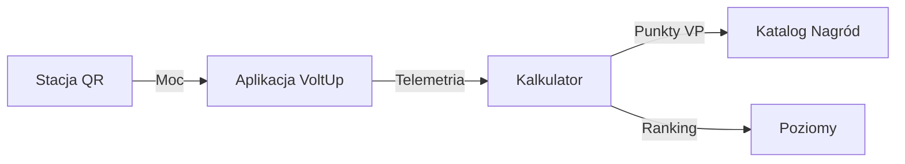

<p align="center">
  <a href="#spis-treści">
    
  </a>
  &nbsp;
  <a href="#table-of-contents">
    
  </a>
</p>

<p align="center">
  <a href="https://skillicons.dev">
    
  </a>
</p>

<p align="center">
  <a href="https://github.com/LukaszMatecki/VoltUp/releases">
    
  </a>
  &nbsp;
  <a href="https://github.com/LukaszMatecki/VoltUp/actions/workflows/release.yml">
    
  </a>
  &nbsp;
  <a href="https://github.com/LukaszMatecki/VoltUp/blob/master/LICENSE">
    
  </a>
</p>

# VoltUp: Miejski Ekosystem Zdrowia i Mikronagród (Health Shift)

<a id="wersja-polska"></a>

VoltUp to ekosystem profilaktyki zdrowotnej, mikronawyków i mikronagród miejskich w Łodzi (ścieżka **Health Shift**), stworzony w technologii **Kotlin Multiplatform** oraz **Compose Multiplatform**. Aplikacja ożywia ponad 120 istniejących siłowni plenerowych w łódzkich parkach, motywując mieszkańców do codziennego ruchu poprzez mechanizm **Proof-of-Effort** (sprzężenie prądnicy z aplikacją), natychmiastowe korzyści (darmowe bilety MPK Łódź, zniżki na basen Fala i do EC1) oraz budowanie regularnych nawyków kardio zalecanych przez WHO.

---

<a id="spis-treści"></a>

## Spis Treści

1. [Architektura KMP i współdzielenie kodu](#architektura-kmp-i-współdzielenie-kodu)
2. [Przepływ danych](#przepływ-danych)
3. [Główne moduły aplikacji](#główne-moduły-aplikacji)
4. [Prezentacja wizualna (zrzuty ekranu)](#prezentacja-wizualna)
5. [Struktura projektu](#struktura-projektu)
6. [Wykorzystane technologie i biblioteki](#wykorzystane-technologie-i-biblioteki)
7. [Uruchomienie projektu i testy](#uruchomienie-projektu-i-testy)
8. [Pobieranie aplikacji i wydania (GitHub Releases)](#pobieranie-aplikacji-i-wydania)
9. [Usługi chmurowe Firebase](#usługi-chmurowe-firebase)
10. [Licencja](#licencja)
11. [Executive Summary (English)](#table-of-contents)

---

## Architektura KMP i współdzielenie kodu

Projekt został zbudowany z wykorzystaniem architektury **Kotlin Multiplatform (KMP)** oraz **Compose Multiplatform**. Całość logiki biznesowej, stanu, kalkulacji energetycznych oraz warstwy widoków UI jest w pełni współdzielona pomiędzy platformami Android i iOS, bez konieczności dublowania kodu.

### Struktura modułów współdzielonych

* **Moduł `/shared/src/commonMain`**: zawiera cały współdzielony interfejs w Compose Multiplatform, modele domenowe, stan aplikacji (MVI/MVVM), kalkulator redukcji emisji dwutlenku węgla oraz silnik osiągnięć i wyzwań tygodniowych.
* **Moduł `/shared/src/androidMain`**: implementuje platformowe mechanizmy systemu Android za pomocą wzorca `expect` / `actual`. Obejmuje integrację z Google Maps SDK for Android (`GoogleMapView.android.kt`), natywną obsługę kamery Jetpack CameraX (`CameraPreview.android.kt`) oraz klienta usług Google Play Services i Firebase Android SDK.
* **Moduł `/shared/src/iosMain`**: dostarcza mosty integracyjne dla systemu iOS, w tym kontroler `MainViewController.kt` osadzający drzewo komponentów Compose w kontrolerze UIViewController.
* **Katalog `/iosApp`**: reprezentuje natywny projekt Xcode dla systemu iOS, stanowiący powłokę wejściową dla aplikacji na urządzeniach Apple (`iOSApp.swift`, `ContentView.swift`).

---

## Przepływ danych



* **Autoryzacja stacji:** Zeskanowanie kodu QR urządzenia za pomocą kamery weryfikuje fizyczną obecność na stacji.
* **Rejestracja sesji:** Aplikacja mierzy moc chwilową, zlicza wytworzoną energię i estymuje redukcję emisji CO2.
* **Grywalizacja i nagrody:** Zakończona sesja zwiększa punkty w rankingu i zasila portfel użytkownika o zdobyte VoltPoints, które można wymienić na kody rabatowe i zniżki.

---

## Główne moduły aplikacji

### Pulpit główny i metryki
Główny ekran prezentuje bieżący poziom użytkownika, liczbę punktów rankingowych, zaoszczędzone CO2 oraz dzienny rozkład energii na dynamicznym wykresie. Moduł FusedLocationProvider automatycznie wylicza odległość w metrach do najbliższej stacji w Łodzi.

### Interaktywna mapa stacji w Łodzi
Oparta o Google Maps Compose z customowymi znacznikami stacji i wskaźnikami statusu. Kliknięcie stacji automatycznie animuje kamerę ze zbliżeniem i synchronizuje kartę urządzenia na liście pod mapą.

### Skaner kodów QR
Wykorzystuje Jetpack CameraX do błyskawicznego odczytu identyfikatora stacji i dodatkowo zawiera wbudowany symulator sprzętowy na potrzeby prezentacji.

### Monitor treningu w czasie rzeczywistym
Przejrzysty interfejs z animowanym wskaźnikiem generowanej mocy, zliczaniem watogodzin i spalonych kalorii oraz pauzą w przypadku braku aktywności lub przerwy.

### System grywalizacji, wyzwań i nagród
Trzydzieści osiągnięć z wieloma poziomami zaawansowania, odnawialne wyzwania tygodniowe oraz katalog kuponów zniżkowych (np. bilety MPK Łódź, zniżki w sklepach parnerskich, gadżety sportowe) generowanych w postaci unikalnych kodów.

---

## Logo aplikacji

<p align="center">
  
</p>
<p align="center">
  <em>Oficjalna ikona aplikacji VoltUp</em>
</p>

---

## Prezentacja wizualna

Wszystkie ekrany zostały zaprojektowane zgodnie z wytycznymi Material Design 3 z pełną obsługą trybu ciemnego i jasnego, jednolitą nawigacją gestami oraz czystym paskiem stanu.

### Kluczowe ekrany aplikacji (Tryb ciemny)

<p align="center">
  
  
  
</p>
<p align="center">
  <em>Pulpit główny ze statystykami &bull; Interaktywna mapa stacji kinetycznych &bull; Monitor aktywnego treningu</em>
</p>

<p align="center">
  
  
  
</p>
<p align="center">
  <em>Skaner kodów QR stacji &bull; Osiągnięcia i ranga miejska &bull; Sklep nagród i kuponów zniżkowych</em>
</p>

<p align="center">
  
  
  
</p>
<p align="center">
  <em>Profil użytkownika i serie treningowe &bull; Archiwum ukończonych sesji &bull; Ustawienia i personalizacja</em>
</p>

### Onboarding i uwierzytelnianie (Tryb jasny)

<p align="center">
  
  
  
</p>
<p align="center">
  <em>Logowanie do konta &bull; Ekran powitalny i wprowadzenie &bull; Samouczek i baza wiedzy FAQ</em>
</p>

> Kompletny zestaw zrzutów ekranu w wysokiej rozdzielczości znajduje się w katalogu `VoltUp_Screenshots/`.

## Struktura projektu

```text
VoltUp/
├── androidApp/
│   ├── src/main/
│   │   ├── AndroidManifest.xml
│   │   └── res/
│   └── google-services.json
│
├── iosApp/
│   ├── iosApp/
│   │   ├── iOSApp.swift
│   │   └── ContentView.swift
│   └── iosApp.xcodeproj/
│
├── VoltUp_Screenshots/
│   ├── bez_ramki/
│   │   ├── ciemny/
│   │   └── jasny/
│   ├── z_ramka/
│   │   ├── ciemny/
│   │   └── jasny/
│   └── voltup_demo.mp4
│
└── shared/
    └── src/
        ├── commonMain/kotlin/com/lumatech/voltup/
        │   ├── App.kt
        │   ├── Models.kt
        │   ├── FirebaseModels.kt
        │   ├── VoltUpAuthService.kt
        │   ├── VoltUpDatabaseService.kt
        │   ├── AchievementSystem.kt
        │   ├── StationsMapScreen.kt
        │   ├── WorkoutScreen.kt
        │   ├── QrScannerScreen.kt
        │   ├── RewardsScreen.kt
        │   ├── ProfileScreen.kt
        │   ├── SettingsScreen.kt
        │   ├── AuthScreens.kt
        │   ├── Localization.kt
        │   └── Theme.kt
        │
        ├── androidMain/kotlin/com/lumatech/voltup/
        │   ├── GoogleMapView.android.kt
        │   ├── CameraPreview.android.kt
        │   └── FirebaseServices.android.kt
        │
        └── iosMain/kotlin/com/lumatech/voltup/
            ├── MainViewController.kt
            ├── GoogleMapView.ios.kt
            └── FirebaseServices.ios.kt
```

---

## Wykorzystane technologie i biblioteki

* **Język bazowy:** Kotlin 2.0 (logika domenowa, coroutines, współdzielony kod dla Androida i iOS)
* **Interfejs graficzny:** Compose Multiplatform (deklaratywne UI, wspólny design system Material Design 3)
* **Usługi chmurowe:** Google Firebase (Firebase Authentication, Cloud Firestore NoSQL)
* **Mapy i geolokalizacja:** Google Maps Compose SDK for Android oraz FusedLocationProviderClient
* **Aparat i optyka:** Jetpack CameraX (analiza kodów QR w czasie rzeczywistym)
* **Zarządzanie stanem:** StateFlow, MutableStateFlow i architektura reaktywna
* **Typografia i zasoby:** Rodzina czcionek Outfit zintegrowana przez Compose Resources

---

## Uruchomienie projektu i testy

### Wymagania wstępne
* Android Studio (wersja Iguana, Jellyfish lub nowsza)
* Java Development Kit (JDK 17 lub JDK 21)
* Android SDK z API level minimum 26 (Android 8.0 Oreo)
* Do kompilacji wersji na iOS: macOS z zainstalowanym środowiskiem Xcode 15+

### Kompilacja i uruchomienie (Android)

System Windows (PowerShell):
```powershell
$env:JAVA_HOME = "C:\Program Files\Android\Android Studio\jbr"
./gradlew.bat :androidApp:assembleDebug
./gradlew.bat :androidApp:installDebug
```

System macOS lub Linux:
```bash
export JAVA_HOME="/Applications/Android Studio.app/Contents/jbr/Contents/Home"
./gradlew :androidApp:assembleDebug
./gradlew :androidApp:installDebug
```

### Uruchomienie wersji na iOS
Otwórz katalog `/iosApp` w środowisku Xcode i uruchom projekt na symulatorze lub fizycznym urządzeniu iPhone.

### Testy jednostkowe
Uruchomienie zestawu testów współdzielonych:

```bash
./gradlew :shared:testAndroidHostTest
./gradlew :shared:iosSimulatorArm64Test
```

---

<a id="pobieranie-aplikacji-i-wydania"></a>

## Pobieranie aplikacji i wydania (GitHub Releases)

Wszystkie oficjalne wydania binarne aplikacji VoltUp są automatycznie budowane i publikowane w sekcji [GitHub Releases](https://github.com/LukaszMatecki/VoltUp/releases).

Każde wydanie zawiera kompletny zestaw gotowych pakietów instalacyjnych:

| Nazwa pliku | Platforma | Format | Przeznaczenie |
| :--- | :--- | :--- | :--- |
| **`VoltUp-Android-debug.apk`** | Android | APK | **Zalecany do testów:** Gotowy do natychmiastowej instalacji na smartfonie Android (podpisany kluczem debugującym). |
| **`VoltUp-Android-release-unsigned.apk`** | Android | APK | Zoptymalizowany pakiet Release pod kątem wydajności i minimalnego rozmiaru. |
| **`VoltUp-Android-release.aab`** | Android | AAB | Oficjalny format Android App Bundle gotowy do publikacji w Google Play Console. |
| **`VoltUp-iOS-Device.ipa`** | iOS | IPA | Paczka instalacyjna dla fizycznych urządzeń iPhone (instalacja przez AltStore, Sideloadly lub Apple Configurator). |
| **`VoltUp-iOS-Simulator.app.zip`** | iOS Simulator | ZIP / .app | Paczka dla symulatorów Xcode (instalacja metodą drag-and-drop na okno symulatora). |

### Jak publikować nowe wydania?
Repozytorium posiada w pełni zautomatyzowany potok CI/CD oparty na GitHub Actions ([`.github/workflows/release.yml`](.github/workflows/release.yml)):

* **Opcja 1 (Automatyczna przez Git Tag):**
  Utwórz i wyślij tag wersji (np. `v1.0.0`):
  ```bash
  git tag -a v1.0.0 -m "Release v1.0.0"
  git push origin v1.0.0
  ```
  GitHub Actions automatycznie skompiluje pakiety dla Androida (APK, AAB) oraz iOS (IPA, Simulator), wygeneruje changelog na podstawie commitów i utworzy oficjalny GitHub Release z załączonymi plikami.

* **Opcja 2 (Ręczna przez interfejs GitHub Actions):**
  1. Przejdź do zakładki **Actions** w repozytorium na GitHubie.
  2. Z menu bocznego wybierz workflow **Publish Release**.
  3. Kliknij przycisk **Run workflow**, podaj numer wersji (np. `v1.0.0`) i zatwierdź.

---

## Usługi chmurowe Firebase

### Kolekcje w Cloud Firestore
* `devices`: lista stacji kinetycznych w Łodzi (współrzędne GPS, nazwa, stan techniczny, moc nominalna).
* `users`: profile użytkowników, punkty rankingowe, saldo VoltPoints, stopień doświadczenia i serie treningowe.
* `workouts`: archiwum zakończonych treningów (czas trwania, średnia moc, watogodziny, ekwiwalent CO2).
* `user_achievements`: stany postępu oraz odblokowane odznaki powiązane z identyfikatorem użytkownika.

### Konfiguracja Google Maps API
Klucz Google Maps API jest zdefiniowany w konfiguracji manifestu oraz modułu mapowego. Wymaga włączonej usługi Maps SDK for Android w konsoli Google Cloud Platform.

---

## Licencja

Projekt VoltUp jest udostępniany na warunkach licencji **MIT**. Szczegóły znajdują się w pliku [LICENSE](LICENSE).

---
---

<a id="table-of-contents"></a>
<a id="english-version"></a>

# VoltUp: Urban Health Gamification & Micro-Rewards (Health Shift)

VoltUp is a cross-platform mobile solution built with **Kotlin Multiplatform** and **Compose Multiplatform**. It bridges urban outdoor workout infrastructure with preventive cardio health, gamification, and municipal micro-rewards across the Lodz metropolitan area.

The system empowers citizens to activate underutilized outdoor fitness stations, track calories and cardio intensity via hardware-backed Proof-of-Effort, charge their mobile devices on-site, and redeem earned reward points for public transit tickets (MPK Łódź) and cultural attractions.

---

## Table of Contents

1. [Key Architectural Highlights](#key-architectural-highlights)
2. [Visual Presentation and UI Showcase](#visual-presentation-and-ui-showcase)
3. [Technology Stack](#technology-stack-1)
4. [Quick Start (Building and Testing)](#quick-start-building-and-testing)
5. [Releases & Downloads](#releases--downloads)
6. [License](#license-1)

---

## Key Architectural Highlights

* **100% Shared UI and Business Logic:** Built with Compose Multiplatform, delivering an identical native look and feel on Android and iOS from a single common codebase (`/shared/src/commonMain`).
* **Platform Integrations via expect/actual:** Hardware-specific capabilities such as Jetpack CameraX optical scanning, Google Maps SDK, and location providers are seamlessly plugged into the shared presentation layer.
* **Real-Time Kinetic Telemetry Engine:** Live tracking of instantaneous power (Watts), cumulative electrical energy (Wh), and carbon offset estimation.
* **Gamification and Micro-Economy:** Thirty progressive achievements, weekly challenges, and a VoltPoints wallet redeemable for partner discount vouchers.
* **Cloud Architecture:** Powered by Google Firebase (Firebase Authentication, Cloud Firestore NoSQL).

---

## Visual Presentation and UI Showcase

> To explore the complete visual showcase of the application in both Dark and Light themes, please refer to the [Prezentacja wizualna (zrzuty ekranu)](#prezentacja-wizualna) section above.
All high-resolution screenshots are organized in the `VoltUp_Screenshots/` directory.

---

## Technology Stack

* **Core Language:** Kotlin 2.0 (Coroutines, Flow, Multiplatform)
* **UI Framework:** Compose Multiplatform with Material Design 3
* **Cloud Backend:** Google Firebase (Auth, Cloud Firestore)
* **Cartography & Geolocation:** Google Maps SDK Compose and FusedLocationProviderClient
* **Camera & Scanner:** Jetpack CameraX with real-time barcode analysis
* **Typography:** Outfit font family integrated via Compose Resources

---

## Quick Start (Building and Testing)

### Android Build
```bash
./gradlew :androidApp:assembleDebug
./gradlew :androidApp:installDebug
```

### iOS Execution
Open the `/iosApp` project in Xcode 15+ and run on an iOS simulator or physical device.

### Running Shared Unit Tests
```bash
./gradlew :shared:testAndroidHostTest
./gradlew :shared:iosSimulatorArm64Test
```

---

<a id="releases--downloads"></a>

## Releases & Downloads

Binary packages for Android and iOS are automatically compiled and published with every release under [GitHub Releases](https://github.com/LukaszMatecki/VoltUp/releases).

| Asset | Platform | Type | Note |
| :--- | :--- | :--- | :--- |
| **`VoltUp-Android-debug.apk`** | Android | APK | **Recommended for quick testing:** Pre-signed with debug key, installs directly on devices. |
| **`VoltUp-Android-release-unsigned.apk`** | Android | APK | Production release binary optimized for performance. |
| **`VoltUp-Android-release.aab`** | Android | AAB | Official Android App Bundle ready for Google Play Store upload. |
| **`VoltUp-iOS-Device.ipa`** | iOS | IPA | Packaged application for physical iOS devices (AltStore / Sideloadly / TestFlight). |
| **`VoltUp-iOS-Simulator.app.zip`** | iOS Simulator | ZIP / .app | Packaged application for Xcode Simulator drag-and-drop installation. |

### Publishing New Releases
1. **Via Git Tag:**
   ```bash
   git tag -a v1.0.0 -m "Release v1.0.0"
   git push origin v1.0.0
   ```
2. **Via GitHub Actions UI:** Navigate to **Actions** -> **Publish Release** -> **Run workflow** and specify the tag version.

---

## License

VoltUp is distributed under the open-source **MIT License**. See the [LICENSE](LICENSE) file for complete details.
